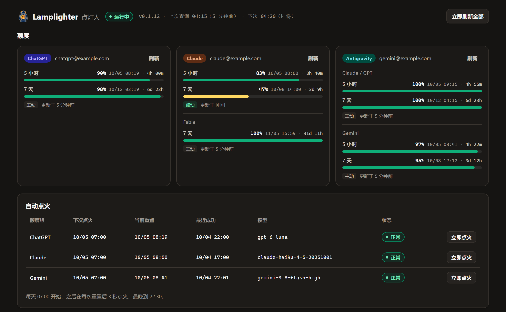
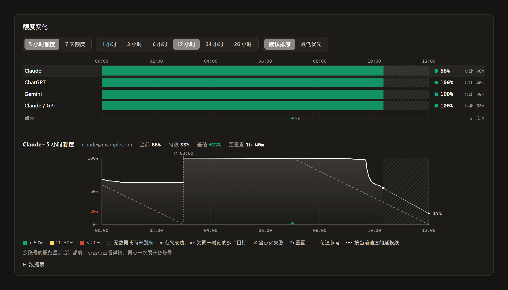
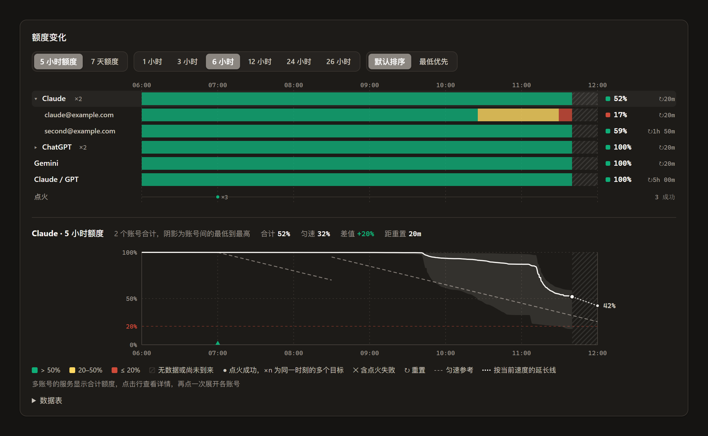

<p align="center"></p>

# Lamplighter

[English](./README_EN.md)

> 当他点燃路灯时，就像他又创造了一颗星星，或者一朵花——《小王子》
>
> 点灯人的星球每分钟转一圈，他就每分钟点一次灯、熄一次灯，从不误点。Lamplighter 做的也是按时点灯：每个 5 小时额度窗口一重置，就点亮下一个窗口。

Lamplighter（点灯人）是 [CLIProxyAPI](https://github.com/router-for-me/CLIProxyAPI)（CPA）的原生插件。它监控 ChatGPT（Codex）、Claude、Antigravity、Kimi 和 Grok 账号的额度，通过 [Bark](https://github.com/Finb/Bark) 或通用 webhook 推送提醒，并在 5 小时额度窗口重置后发送一个极小的请求，让下一个窗口立即开始计时。







## 功能

- **额度监控**：定时主动查询额度，同时读取 CPA 处理真实请求时上游返回的额度信息。
- **通知**：通过 Bark 或 webhook（飞书、ntfy、钉钉、Telegram 等）推送。剩余额度降到 50%、20%、10% 和耗尽时提醒，账号套餐变化（例如会员到期）时提醒；可选的恢复通知和重置前提醒；可选转发 [Did Codex Reset](https://didcodexreset.com/zh.html) 的重置信号。
- **自动点火**：每天 07:00 起，在每次 5 小时窗口重置后 3 秒发送最小请求，最晚到 22:30。请求经过 CPA 自己的模型执行器，并锁定到指定账号。
- **管理页面**：在 CPA 管理中心查看各账号额度、点火计划、事件和额度变化图表，并修改设置。

| 服务 | 监控范围 | 默认点火 |
| --- | --- | --- |
| ChatGPT / Codex | 5 小时、7 天 | 开启 |
| Claude | 5 小时、7 天，以及 Fable 等单独计算的额度 | 开启，只点 5 小时窗口 |
| Antigravity | Gemini、Claude / GPT 等额度组 | 关闭；开启后默认只点 Gemini |
| Kimi | 5 小时、7 天等窗口 | 不支持：窗口按固定时间切换 |
| Grok | 7 天 | 不支持：新周期在上一周期结束时自动开始 |

Kimi 的额度查询按 CPA 管理中心的实现编写，解析用一位用户提供的真实返回测试过，还没有在真实账号上运行过。按 API 用量计费的 Grok 账号没有额度可查，会显示错误。没有 5 小时窗口的账号（例如 ChatGPT Pro）只监控其他窗口，不点火。

通知和页面中，ChatGPT 账号的额度组名为 `GPT`，与 Claude 的首字母不同，便于区分。同一服务有多个账号时，通知和页面用邮箱用户名的最后两个字符区分，例如 `GPT#rk`。给账号起名后改用名称，例如 `GPT#主力号`：在 Lamplighter 页面点账号卡片上的“命名”，或在 CPA 管理中心编辑凭证的“备注（note）”。名称是备注的第一行，超过 20 个字时截断；只有一个账号的服务也显示名称；名称与同一服务另一个账号的名称或邮箱后缀相同时，名称后再加邮箱后缀。备注有多行时，在 Lamplighter 页面清空名称会删除整条备注。在 CPA 管理中心改的备注在下一轮查询或手动刷新后生效。已记录的事件保留原来的标签。

同一服务有多个账号时，图表中的合计按权重平均各账号的剩余额度，权重表示账号的额度是该服务最便宜付费套餐的几倍。默认权重按识别到的套餐确定，账号卡片底部显示套餐名；ChatGPT 的套餐取自额度查询的结果；Claude 和 Antigravity 的套餐每个账号每天读取一次账号资料，账号返回的额度窗口有增减时立即重读，例如 Google AI Pro 到期后 Gemini 的 5 小时窗口消失时。读取失败时沿用上次读到的套餐，从未读到时权重为 1。点账号卡片上的“权重”可以手动设置，可带小数，留空则恢复默认值；手动设置的权重保存在 `account_weights` 中，优先于默认值。权重不是 1 时，账号标题后显示倍数，例如 `×5`。

| 服务 | 套餐 | 默认权重 |
| --- | --- | --- |
| ChatGPT | Free、Go | 0.1 |
| ChatGPT | Plus、Business、Enterprise、Edu | 1 |
| ChatGPT | Pro $100、Business Premium | 5 |
| ChatGPT | Pro $200 | 10 |
| ChatGPT | Pro $500 | 25 |
| Claude | Pro、Team、Enterprise | 1 |
| Claude | Max 5x | 5 |
| Claude | Max 20x | 20 |
| Antigravity | Free、Pro、Ultra | 1 |

其他服务和未识别的套餐默认权重为 1。

账号的套餐变化时（例如 Google AI Pro 到期或续订），插件推送一条 🎫 通知，例如 `🎫 Antigravity · 套餐 Pro → Free`。之后这个账号的额度提醒按新套餐的额度重新开始：新套餐的额度只记录，不当作额度恢复或下降来提醒。第一次读到套餐时只记录，不推送。Claude 的套餐每天读取一次，套餐变化后、读到新套餐之前，额度提醒仍按旧套餐的额度比较。套餐比额度窗口晚变化，或读取套餐连续失败超过 1 小时时，同样会按旧套餐的额度比较，可能发出一条错误的恢复或下降提醒。

## 要求

- CPA v8.0.4 或更新版本，并开启插件（`plugins.enabled: true`）。插件提供 Linux amd64/arm64、macOS amd64/arm64 和 Windows amd64 版本；macOS 版本只在 CI 中构建和测试，还没有在实际运行的 CPA 上验证。
- 一个专门给 Lamplighter 用的 CPA API key。插件用它读取模型列表来选择点火模型。
- 需要通知时，一台装有 Bark 的 iPhone，或者一个能接收 webhook 的服务。

## 安装

1. 在 [Releases](https://github.com/PosvdM/cpa-plugin-lamplighter/releases) 下载与 CPA 所在系统对应的 zip：Linux 上 `uname -m` 显示 `x86_64` 时选 `linux_amd64`，显示 `aarch64` 时选 `linux_arm64`；Apple 芯片的 Mac 选 `darwin_arm64`，Intel 芯片的 Mac 选 `darwin_amd64`；Windows 选 `windows_amd64`。
2. 解压出动态库（Linux 为 `lamplighter-v<版本>.so`，macOS 为 `.dylib`，Windows 为 `.dll`），放进 CPA 插件目录下的 `<系统>/<架构>/` 子目录，例如 `plugins/linux/arm64/` 或 `plugins/windows/amd64/`。Docker 部署时，插件目录是挂载到容器 `/CLIProxyAPI/plugins` 的宿主机目录。
3. 在 CPA 的 `config.yaml` 中新增一个 API key，并启用插件：

   ```yaml
   access:
     api-keys:
       - "已有的 key"
       - "给 Lamplighter 新建的 key"
   plugins:
     enabled: true
     configs:
       lamplighter:
         enabled: true
         models_api_key: "给 Lamplighter 新建的 key"
         bark_url: "https://api.day.app/你的device_key"
   ```

4. 重启 CPA（Docker 部署时运行 `docker compose restart`）。插件在 CPA 启动约 20 秒后开始第一次查询。
5. 打开管理中心侧边栏的 **Lamplighter** 页面。如果登录管理中心时勾选了“记住密码”，页面会直接使用该密钥，否则会请你输入。

插件每 6 小时检查一次新版本，打开管理页面时也检查一次。有新版本时，管理页面标题栏的版本号右边出现绿色的向上箭头，点击打开该版本的 Release 页面。升级时，在 CPA 管理中心的插件商店中更新；手动安装的，把新版本的动态库放进同一目录，删除旧版本文件，再重启 CPA。

插件的状态和额度历史保存在插件目录下的 `data/lamplighter/`。Docker 部署时插件目录已经挂载在宿主机上，重建容器不会丢失这些数据。

## 额度怎么获取

**主动查询**：默认每 5 分钟一次，固定在每小时的 `00 / 05 / 10 / ... / 55` 分钟。此外，每个额度窗口重置前 30 秒和重置后 30 秒，插件各对这个账号再查询一次：前一次记录这个周期最后的剩余额度，后一次确认新周期并及时发出恢复通知。这段时间里已有新读数时不再查询。请求地址和请求头与 CPA 管理中心额度页发出的请求相同。

**被动读取**：Claude 和 Codex 的模型请求经过 CPA 时，上游会在响应里返回当前额度，插件直接使用这些数据，不额外发请求。Antigravity、Kimi 和 Grok 没有这类数据，只能主动查询。额度接口没有返回、只出现在响应头里的窗口，在主动查询之后不再显示，例如 ChatGPT Pro 账号的 5 小时窗口。

如果某个账号在整点前 60 秒内刚有过被动数据，这一轮就跳过对它的主动查询。同一账号最多连续跳过 30 分钟，到时一定主动查询一次，以便更新没有出现在响应头里的额度，例如没在使用的 Claude Fable 额度。图表不把这段计划内的间隔画成缺数据。

Claude 和 Codex 的额度无论主动还是被动获取，都精确到 1%；Antigravity 的主动查询结果带小数；Kimi 按已用量和上限换算，可能带小数。

窗口在套餐升级时消失、降级后重新出现时，首次返回只记录新的提醒基线，不发送恢复通知或重置前提醒。窗口消失不通知；主动查询确认的缺席状态跨插件重启保留，被动响应头不会恢复缺席窗口，只有后续成功的主动查询才能恢复。没有 5 小时窗口时跳过点火，恢复后自动继续。历史记录保留消失的窗口。

**网络出口**：主动查询和 CPA 发送模型请求时使用同一个出口，依次是：账号自己的 `proxy_url`、全局 `proxy-url`、环境变量中的代理、直连。账号配置的 `proxy_url` 无法解析时，插件跳过这次查询，不会改用直连。

## 自动点火

5 小时额度窗口从重置后的第一个请求开始计时。重置后没人使用时，窗口不会开始。Lamplighter 在每次重置后立即发一个请求，让窗口连续滚动。Kimi 的窗口按固定时间切换，Grok 没有 5 小时窗口，这两个服务不点火。点火规则如下：

- 时间均按插件时区计算，默认跟随 CPA 服务器。
- 每天 `07:00` 第一次点火，之后在每次重置后 3 秒点火，最晚到 `22:30`。晚于这个时间的重置顺延到第二天 07:00。
- 请求只要求模型回复 `OK`，不带工具，最多输出 4 个 token。
- 点火模型自动选择：ChatGPT 用最新的 Luna，Claude 用最新的 Haiku，Antigravity 的 Gemini 组用最新的 Flash。CPA 列出新模型后，下一次点火就会使用它；上游拒绝这个模型时，这次点火改用下一个候选模型；换用成功时在事件中记录，这个额度组 24 小时内不再尝试被拒的模型。也可以在配置中指定。
- 请求发出后，插件确认 5 小时窗口有了一个固定的未来重置时间，才算点火成功。

**失败保护**：

- 认证失败、限流（429）、模型不可用，或请求成功但窗口没有开始，都会让这个额度组停止点火到第二天 07:00，并推送一次通知。
- 网络错误和服务端错误先在 5 分钟、15 分钟后重试；第三次仍失败，同样停到第二天。
- 额度在重置前用完时，CPA 会把账号冷却到重置后十几秒。点火撞上这段冷却时，等冷却结束后立即重试，不算失败。
- 同一账号的 7 天额度（或其他非 5 小时窗口）用完时，这个额度组不再自动点火，等到该窗口重置、查询看到额度恢复后继续；页面状态显示“7 天额度已用完”。“立即点火”不受影响。
- 额度提前恢复（例如用了重置卡）而 CPA 仍按原重置时间冷却这个账号时，期间所有请求和点火都会被 CPA 拒绝。插件发现后推送一次 ⚠️ 提醒，并在账号卡片上提示，需要在 CPA 管理中心手动清除这个账号的冷却。

## 通知示例

通知使用最近一次打开管理页面时管理中心的语言（中文或英文），从没打开过时使用中文。

```text
🟡 Claude · 7d 48% | 03d

5h：96% | 04h | 10/04 13:50
7d：48% | 03d | 10/07 14:00
```

标题前的图标：🟡 剩余降到第一档（默认 50%），🔴 降到第二档（默认 20%）及以下，✅ 额度恢复，⏰ 重置提醒，🎫 套餐变化，⚠️ 点火暂停、CPA 冷却未解除等需要处理的问题。正文每行依次是：窗口、剩余额度、距离重置的时间、重置时间。第一次看到某个额度窗口时只记录当前状态，不推送。

## 配置

所有配置都写在 `config.yaml` 的 `plugins.configs.lamplighter` 下，也可以通过管理页面顶部的“额度 | 设置”切换到“设置”视图修改。开关和勾选框点击后自动保存，文本和数字在离开输入框或按回车时自动保存；字段旁显示保存结果。三档提醒阈值一起保存，必须满足从高到低的顺序，可以相等。配置修改后插件自动应用，不需要重启。保存成功后显示“已保存，等待生效”，插件确认后显示“已生效”；15 秒内未确认则显示“未确认生效”。MCP 设置还会显示接口未启动的原因。

| 配置项 | 默认值 | 说明 |
| --- | --- | --- |
| `bark_url` | 空 | Bark 推送地址，写到 device key 为止；为空时不通过 Bark 推送 |
| `bark_group` | `CPA` | Bark 通知分组 |
| `bark_icon` | Lamplighter 图标 | 通知图标 |
| `webhook` | 空 | 通用 webhook，见 [Webhook](#webhook) |
| `notice_threshold` | `50` | 第一档提醒阈值（剩余百分比） |
| `low_threshold` | `20` | 第二档提醒阈值 |
| `critical_threshold` | `10` | 第三档提醒阈值 |
| `recovery_notify` | 5 小时 `after_exhausted`，7 天 `all` | 额度恢复时通知，见下文 |
| `reset_reminder` | 5 小时 `off`，7 天 `has_remaining` | 重置前提醒，见下文 |
| `timezone` | 空 | 显示时间和点火时段使用的时区，如 `Asia/Shanghai`；为空时跟随 CPA 服务器的时区（官方 Docker 镜像由 `TZ` 设置） |
| `timezone_offset_hours` | 空 | 固定的 UTC 偏移，例如 `8`；只在 `timezone` 为空时使用 |
| `poll_interval_seconds` | `300` | 主动查询间隔，最小 60 |
| `request_timeout_seconds` | `20` | 单次上游请求超时 |
| `passive_skip_seconds` | `60` | 整点前多少秒内有被动数据时跳过主动查询；`0` 表示不跳过 |
| `passive_skip_max_minutes` | `30` | 同一账号最多连续跳过多少分钟 |
| `models_api_key` | 空 | 读取模型列表用的 CPA API key；未设置时自动点火无法选择模型。不能使用管理密钥；在页面上修改时，管理密钥和 CPA 不接受的 key 不会保存，页面会提示原因 |
| `cpa_base_url` | `http://127.0.0.1:8317` | 插件访问 CPA 自身的地址；CPA 改了端口或开启 TLS 时需要同步修改 |
| `history_retention_days` | `40` | 额度历史保留天数 |
| `remember_chart_filters` | `false` | 管理页面在当前浏览器中记住“额度变化”上次选择的额度窗口、时间范围和排序；关闭时每次打开页面都使用默认选择 |
| `account_weights` | 空 | 多账号合计中各账号的权重，键为凭证文件名，值为大于 0 的数字；未设置的账号使用套餐的默认权重，见上文 |
| `account_order` | 空 | 账号顺序，按凭证文件名排列；未列出的账号按默认顺序排在后面，不存在的条目忽略 |
| `mcp_enabled` | `false` | 启用独立 MCP 服务，见 [MCP](#mcp) |
| `mcp_listen` | `127.0.0.1:8318` | MCP 监听地址 |
| `mcp_key` | 空 | MCP 专用 Bearer 密钥；为空时不启动监听 |
| `config_token` | 空 | 页面每次保存时生成的配置确认令牌，通常无需手动设置；确认机制见[架构文档](./docs/architecture.md#与-cpa-的接口) |
| `data_dir` | 插件目录下的 `data/lamplighter` | 状态和历史目录 |

提醒阈值按 `100 ≥ notice_threshold ≥ low_threshold ≥ critical_threshold ≥ 0` 规整，后两档不能高于前一档；规整后的值生效，并写入日志。

`bark_url` 和 `webhook.url` 都为空时通知关闭：不发送任何通知，也不在事件中记录推送失败。之后再填上地址，关闭期间的额度提醒不会补发；Did Codex Reset 的信号还没过期的会照常推送。

恢复通知和重置前提醒按窗口分别设置，`five_hour` 对应 5 小时窗口，`seven_day` 对应 7 天窗口：

| 配置项 | 取值 | 说明 |
| --- | --- | --- |
| `recovery_notify` | `off`、`all`、`after_exhausted` | `all`：窗口每次重置都通知；`after_exhausted`：窗口用完后，只在下一次重置时通知一次 |
| `reset_reminder` | `off`、`all`、`has_remaining` | 5 小时窗口在重置前 1 小时提醒，7 天窗口在重置前 1 天提醒；`has_remaining`：只在剩余高于 `critical_threshold` 时提醒 |

恢复通知的第一行是上一周期结束时的剩余额度。这个值来自重置前 30 秒的那次主动查询，最后 30 秒内的用量不计入。找不到重置前 15 分钟内的读数时不显示这一行。上一周期从没用过（重置前仍是 100%）时不通知。既不是 5 小时也不是 7 天的窗口，曾在距离重置超过 1 天时出现过的按 7 天窗口处理，其余按 5 小时窗口处理。

`notify_recovery` 和 `notify_reset_reminders` 为 `true` 时等同于对应配置的两个窗口都设为 `all`，为 `false` 时都设为 `off`，只在没有写 `recovery_notify` 或 `reset_reminder` 时生效；在管理页面修改对应的通知设置后会换成新的写法。

点火相关设置在 `ignition` 下：

| 配置项 | 默认值 | 说明 |
| --- | --- | --- |
| `enabled` | `true` | 是否自动点火 |
| `start_hour` | `7` | 每天第一次点火的时间（时） |
| `end_hour` | `22` | 每天停止点火的时间（时） |
| `end_grace_minutes` | `30` | `end_hour` 之后再顺延的分钟数 |
| `grace_seconds` | `3` | 重置后延迟多少秒点火 |
| `failure_retry_seconds` | `300` | 临时错误后第一次重试的等待时间 |
| `failure_backoff_multiplier` | `3` | 每次重试等待时间的倍数 |
| `max_transient_failures` | `3` | 临时错误达到这个次数后停到第二天 |
| `post_success_hold_seconds` | `60` | 点火成功后至少等待多久才可能再次点火 |

各服务的设置在 `providers` 下，键名为 `codex`、`claude`、`antigravity`、`kimi`、`xai`（Grok）。CPA 中 Kimi 账号的服务名也可能是 `kimi-ai` 等写法，配置中写哪一种都按 `kimi` 处理。Kimi 和 Grok 不支持点火，`ignite` 对它们不起作用：

| 配置项 | 说明 |
| --- | --- |
| `monitor` | 是否监控 |
| `ignite` | 是否自动点火 |
| `model` | 指定点火模型，留空时自动选择；必须出现在 CPA 的模型列表中 |
| `groups` | 仅 Antigravity：允许点火的额度组，默认 `["Gemini"]` |
| `models` | 仅 Antigravity：按额度组指定模型，例如 `{"Gemini": "gemini-3.5-flash-lite"}` |

`codex_reset_updates` 控制 Did Codex Reset 转发：`enabled`（默认 `false`）、`poll_seconds`（默认 `300`，最小 300）、`notify_current_pending`（默认 `true`，第一次开启时推送当前尚未生效的排期）。只转发尚未到期的排期和 48 小时内的完成记录，同一次排期有多条帖子时，只在置信度、时间或范围变化时作为排期更新再推送；排期时间按本地时区显示，只给出日期的排期显示为时间段。Did Codex Reset 是第三方监测站，它的信号不代表 OpenAI 官方确认。

完整示例：

```yaml
plugins:
  configs:
    lamplighter:
      enabled: true
      bark_url: "https://api.day.app/你的device_key"
      models_api_key: "给 Lamplighter 新建的 key"
      ignition:
        enabled: true
        start_hour: 7
        end_hour: 22
      providers:
        codex:
          ignite: true
        claude:
          ignite: true
        antigravity:
          ignite: true
          groups: ["Gemini"]
      codex_reset_updates:
        enabled: true
```

## MCP

MCP 让编码 Agent 通过标准 Streamable HTTP 查询额度，不依赖具体客户端。插件独立监听 `127.0.0.1:8318`，路径为 `/mcp`，使用专用 Bearer 密钥；CPA 管理密钥不能用于此接口。支持协议版本 `2025-03-26` 和 `2025-06-18`，只返回 JSON，不提供 SSE。

在“设置”视图中开启 MCP；没有密钥时，页面在同一次保存中生成密钥。也可以单独生成新密钥，或在 `plugins.configs.lamplighter` 下配置：

```yaml
mcp_enabled: true
mcp_listen: "127.0.0.1:8318"
mcp_key: "<MCP 专用密钥>"
```

密钥应使用密码学随机数生成器生成，例如 32 字节随机数的 base64url 编码加上 `llmcp_` 前缀。留空时不启动服务，管理状态显示原因。开关、监听地址和密钥修改后自动应用。状态接口的 `config.mcp_key_set` 只表示是否设置密钥；配置是否完成应用由顶层 `config_applied_token` 确认，接口能否使用还需查看运行状态和错误信息。密钥原文保存在 CPA 配置中，拥有管理密钥的人可以读取。Docker 中该地址位于 CPA 容器内；同机 Agent 可以共享网络，其他部署应通过受限容器网络连接反向代理，避免发布未加密的 MCP 端口。

### 客户端连接

同一网络命名空间中的默认地址为 `http://127.0.0.1:8318/mcp`。远程连接请替换为 HTTPS 地址。以下示例中的 `<key>` 是 MCP 专用密钥。

Claude Code：

```sh
claude mcp add --transport http lamplighter http://127.0.0.1:8318/mcp --header "Authorization: Bearer <key>"
```

Codex CLI（密钥通过环境变量提供）：

```sh
export LAMPLIGHTER_MCP_KEY='<key>'
codex mcp add lamplighter --url http://127.0.0.1:8318/mcp --bearer-token-env-var LAMPLIGHTER_MCP_KEY
```

通用客户端配置示例（字段格式以客户端文档为准）：

```json
{"mcpServers":{"lamplighter":{"type":"http","url":"http://127.0.0.1:8318/mcp","headers":{"Authorization":"Bearer <key>"}}}}
```

只支持 stdio 的客户端可以通过 `mcp-remote` 连接：

```sh
npx mcp-remote http://127.0.0.1:8318/mcp --header "Authorization: Bearer <key>"
```

### HTTPS 反向代理

不建议直接监听公网。远程使用时，保持 MCP 监听回环地址，由同机反向代理终止 TLS，并按需增加防火墙或访问白名单。代理需要保留 `Authorization` 和 `MCP-Protocol-Version` 请求头；带非本机 `Origin` 的浏览器请求会被拒绝，普通 MCP Agent 通常不发送这个头。

Nginx 示例（替换域名和证书路径）：

```nginx
server {
    listen 443 ssl;
    server_name quotas.example.com;
    ssl_certificate /etc/letsencrypt/live/quotas.example.com/fullchain.pem;
    ssl_certificate_key /etc/letsencrypt/live/quotas.example.com/privkey.pem;
    location = /mcp {
        proxy_pass http://127.0.0.1:8318/mcp;
        proxy_set_header Authorization $http_authorization;
        proxy_set_header MCP-Protocol-Version $http_mcp_protocol_version;
        proxy_read_timeout 190s;
    }
}
```

Caddy 示例（域名解析到代理，Caddy 自动申请 HTTPS 证书）：

```caddyfile
quotas.example.com {
    reverse_proxy /mcp 127.0.0.1:8318 {
        transport http {
            response_header_timeout 190s
        }
    }
}
```

### 工具

| 工具 | 用途 |
| --- | --- |
| `list_quotas(provider?, account?, model?)` | 当前窗口、各账号套餐和权重、加权剩余、最早耗尽账号、重置和预计耗尽时间、每小时消耗、7 天匀速预算、数据来源与新鲜度、凭据认证错误及下次点火时间 |
| `get_quota_history(provider?, account?, window?, range?)` | 历史额度，包括已消失的窗口；每个系列最多 200 点，单次最多 2000 点 |
| `refresh_quotas(account?)` | 主动查询；全局每 60 秒最多一次，超限返回等待秒数，等待结果最多 180 秒 |
| `get_quota_events(since?, limit?)` | 最近的重置、耗尽、点火成功和失败；`since` 为带时区的 RFC 3339 时间，`limit` 为 1–100 的整数 |

每个 MCP 服务实例最多同时执行 4 次工具调用，批处理内的调用也占用同一组名额；超出时立即返回 JSON-RPC `-32000` 忙碌错误，可稍后重试。查询工具超时为 10 秒，`refresh_quotas` 为 180 秒。

`account` 按备注第一行或邮箱精确匹配，重名刷新时需改用唯一邮箱。没有备注和邮箱的账号使用 `account-序号`。时间同时包含带时区的 ISO 时间和相对时间。预测取决于使用速度，不能保证准确；数据过旧或无法判断时相应字段为 `null`。`model` 查询返回候选额度组并标记 `certain: false`：CPA 在实际请求中还会应用模型别名、凭据可用性、冷却和会话路由，插件不能保证最终选中哪个账号。遇到 429 时先主动刷新，再结合实际重置时间和 CPA 冷却时间安排重试，不应只依据预计耗尽时间。事件从最近保留的最多 200 条引擎事件中筛选。

## Webhook

除了 Bark，还可以配置一个 webhook，把通知发到飞书、ntfy、钉钉、Telegram 等服务或者自己的程序。两个渠道都配置时，每条通知同时发给两边；只要有一边发送成功就算送达，不再重试，失败的一边在事件中记为“推送失败”。

| 配置项 | 默认值 | 说明 |
| --- | --- | --- |
| `url` | 空 | 请求地址；为空时不启用 |
| `method` | `POST` | `GET`、`POST` 或 `PUT` |
| `headers` | 空 | 请求头，例如 `Authorization: Bearer <token>` |
| `body` | 空 | 请求体；为空时发送内置的 JSON 消息。`GET` 请求不能设置 |
| `success_json` | 空 | 成功条件：JSON 响应中这些顶层字段必须等于给定的值，例如 `code: 0`；为空时只要求 HTTP 状态码为 2xx |

地址、请求头和请求体中可以使用占位符：

| 占位符 | 内容 |
| --- | --- |
| `{{title}}` | 通知标题 |
| `{{body}}` | 通知正文 |
| `{{text}}` | 标题和正文，中间换行 |
| `{{url}}` | 跳转链接，只有 Did Codex Reset 通知有，其余为空 |
| `{{priority}}` | 额度降到第三档或耗尽、套餐变化、点火暂停、CPA 冷却未解除时为 `high`，其余为 `normal` |
| `{{kind}}` | 通知类型：`quota` 额度下降、`recovery` 额度恢复、`reminder` 重置提醒、`plan` 套餐变化、`cooldown` CPA 冷却未解除、`circuit` 点火暂停、`codex_reset` Did Codex Reset、`test` 测试推送 |
| `{{label}}` | 额度组，例如 `GPT#rk` 或 `GPT#主力号`；与额度组无关的通知为空 |
| `{{time}}` | 发送时间，RFC 3339 格式，使用插件时区 |

占位符按所在位置自动转义：地址中做 URL 编码；JSON 请求体中做 JSON 字符串转义，所以要写在引号里；表单请求体中做表单编码；请求头中把换行换成空格。没有设置 `Content-Type` 请求头时，请求体是 JSON（占位符写在引号里）就按 JSON 发送，否则按纯文本发送。

不写 `body` 时发送的 JSON：

```json
{"source":"lamplighter","kind":"quota","title":"🔴 GPT#rk · 5h 8% | 03h","body":"5h：8% | 03h | 10/10 19:00\n7d：60% | 04d | 10/14 09:00","text":"…","url":"","priority":"high","label":"GPT#rk","time":"2026-10-10T16:00:00+08:00"}
```

常见服务的写法如下。这些是按各服务文档整理的格式示例，没有逐一实测。

| 服务 | `url` | `body` | `success_json` |
| --- | --- | --- | --- |
| ntfy | `https://ntfy.sh/` | `{"topic":"<topic>","title":"{{title}}","message":"{{body}}"}` | 不需要 |
| 飞书 | `https://open.feishu.cn/open-apis/bot/v2/hook/<token>` | `{"msg_type":"text","content":{"text":"{{text}}"}}` | `code: 0` |
| 钉钉 | `https://oapi.dingtalk.com/robot/send?access_token=<token>` | `{"msgtype":"text","text":{"content":"{{text}}"}}` | `errcode: 0` |
| 企业微信 | `https://qyapi.weixin.qq.com/cgi-bin/webhook/send?key=<key>` | `{"msgtype":"text","text":{"content":"{{text}}"}}` | `errcode: 0` |
| Discord | `https://discord.com/api/webhooks/<id>/<token>` | `{"content":"{{text}}"}` | 不需要 |
| Slack | `https://hooks.slack.com/services/<path>` | `{"text":"{{text}}"}` | 不需要 |
| Telegram | `https://api.telegram.org/bot<token>/sendMessage` | `{"chat_id":"<chat_id>","text":"{{text}}"}` | 不需要 |

以飞书为例，在 `config.yaml` 中写成下面这样。请求体含有 `{{`，要用单引号括起来：

```yaml
plugins:
  configs:
    lamplighter:
      webhook:
        url: "https://open.feishu.cn/open-apis/bot/v2/hook/<token>"
        body: '{"msg_type":"text","content":{"text":"{{text}}"}}'
        success_json:
          code: 0
```

- 飞书、钉钉和企业微信在发送失败时也返回 HTTP 200，错误码写在响应里，所以要设置 `success_json`，否则失败的推送会被当作成功。
- 插件不支持飞书和钉钉机器人的“签名校验”。请在机器人的安全设置中改用“自定义关键词”或 IP 白名单；使用关键词时，把它写进请求体，例如 `"text":"Lamplighter {{text}}"`。
- 管理页面的“测试推送”逐个显示每个渠道的结果和 webhook 响应的开头。没有设置 `success_json` 时，页面会提示只检查了 HTTP 状态码，需要到客户端确认是否收到。
- webhook 设置有误（例如占位符拼错）时，webhook 不启用，管理页面顶部显示原因，其他设置照常生效。

## 管理页面

页面顶部通过“额度 | 设置”切换视图，浏览器记住上次打开的视图。“额度”视图包含：

- 各账号的额度窗口、重置时间、数据来源和套餐，可以单独刷新某个账号、给它命名或设置它在合计中的权重；通过卡片上的拖拽手柄或上移、下移按钮调整顺序，保存为 `account_order`，图表默认顺序随之调整；
- 额度条和图表共用五档颜色：原始剩余值为 100% 时为“满”，0% 时为“空”，中间按前两档提醒阈值分为“高”“中”“低”；99.6% 即使显示为 100% 也不按满额着色；
- 每个额度组的下次点火时间、最近一次结果和失败保护状态，可以立即点火；关闭自动点火时不显示这部分；
- 额度变化图表：
  - 先选 5 小时或 7 天额度。5 小时额度可看 1、3、6、12、24、26 小时（默认 6 小时），7 天额度可看 1、4、8、15 天、1 个月（上月这一天起）和 36 天（默认 8 天）。窗口种类和图表行包含当前窗口及所选范围内的历史窗口；当前存在但范围内没有新样本的窗口仍保留一行，缺少样本的区间显示为缺数据。其他长度的窗口只在账号卡片上显示。开启 `remember_chart_filters` 后，页面记住上次的选择。
  - 1、3 小时和 1、4 天显示到现在为止。更长的范围以所选行当前窗口的重置时间为右端，例如 6 小时显示当前 5 小时窗口和上个窗口的最后 1 小时；现在之后的部分画成斜纹。所选行没有重置时间，或重置时间已过（5 小时窗口还没有被新请求开启）时，同样显示到现在为止。
  - 上半部分每个服务一行色带，颜色与额度条相同，按每个周期内的最低读数着色。默认跟随账号卡片顺序，同一服务以其第一个账号的位置排列，同一账号内按额度组顺序排列，也可按剩余最低排序；同一服务有多个账号时显示按权重计算的合计，点击可展开各账号。
  - 账号不再报告的窗口标为“已停用”，保留到最后一个样本移出所选范围。它单独成行，不参与多账号合计和剩余最低排序；曲线停在最后读数，不显示匀速参考线或延长线。
  - 下半部分是所选行的曲线，标出重置时刻和点火结果，并按当时记录的预定重置时间画匀速参考线，以固定的 5 小时或 7 天为周期长度，从 100% 线性降到预定重置时的 0%。提前重置时，旧参考线在首次读到新重置时间的位置截断，新参考线按新的预定重置时间计算；重置时间未知时不画。曲线在线上方说明用得比匀速慢。合计行只在所有账号都有参考值的区间画出按权重平均的参考线。曲线上方显示当前剩余、此刻的匀速参考值和两者的差值，高于匀速为绿色，低于为红色。显示到现在为止时，图表右侧也在曲线和参考线的末端标出这三个值。
  - 右端是重置时间时，从现在画一条延长线：先用完时在时间轴上标出用完的时间（7 天额度带日期），先到重置时在图表右侧标出届时的剩余额度。
    - 5 小时额度按当前速度延伸，表示照这个速度用下去的结果。当前速度取本周期最近一段用量稳定的时间，刚开始大量使用的几分钟内，估计的用完时间偏早。
    - 7 天额度按本周期的日均用量延伸：本周期已用的额度除以周期开始以来的时间，不使用的时间也算在内。周期刚开始的一两天，估计偏差较大。
  - 页面每 30 秒读取一次状态，有新数据时更新图表；鼠标停在图表上时，等移开后再更新。
- 最近的事件，按时间、类型、额度组和详情分列显示。

标题栏的眼睛按钮可切换“打码账号”和“显示账号”。打码会模糊页面中显示的账号标识，刷新页面后恢复显示；命名等操作对话框仍使用原文。打码只影响显示，不删除接口或页面中的原始数据。

账号卡片、卡片区标题栏和曲线详情标题栏的相机按钮，分别将单张卡片、全部卡片和详情图复制为 PNG 图片到剪贴板。截图保留当前主题和打码状态，不包含操作按钮。此功能需要浏览器支持图片剪贴板，并在 HTTPS 或 localhost 等安全上下文中获得剪贴板权限；不支持时按钮不可用。

“设置”视图包含通知、自动点火、服务和 MCP 等配置。通知设置中的“测试推送”等待保存完成，再通过配置令牌最多等待 15 秒确认插件已应用配置；确认后向所有已配置的渠道发送并逐个显示结果，超时则提示“配置尚未生效，未发送测试”，不会发送。点火模型留空时，输入框的提示文字显示下一次点火将使用的模型；Antigravity 显示 Gemini 组的模型。不支持点火的服务显示“不支持点火”。模型列表在插件启动、修改 `cpa_base_url` 或 `models_api_key` 和每次点火时读取，所以 CPA 列出的新模型在下一次点火后才显示，点火本身会直接使用新模型。

页面语言跟随 CPA 管理中心：简体或繁体中文显示中文，其他语言显示英文。

## 安全与风险

- 插件只在内存中读取凭证文件里的 access token 用于查询额度，不写入日志或磁盘。管理页面的数据接口需要 CPA 管理密钥，MCP 接口使用独立密钥。
- `bark_url`、`webhook`、`models_api_key` 和 `mcp_key` 以明文保存在 CPA 的 `config.yaml` 中，有管理密钥的人可以看到。
- 各服务对第三方工具使用订阅账号有不同限制。通过 CPA 使用账号、定时发送点火请求和查询额度，都可能带来账号风险，请自行判断。

## 开发

插件结构、数据流和设计约束见 [架构文档](./docs/architecture.md)，构建、测试和发布见 [开发文档](./docs/development.md)。

## 许可证

[AGPL-3.0-or-later](./LICENSE)。分发修改后的版本，或通过网络向他人提供修改后的版本时，需要按同一许可证公开源代码。
