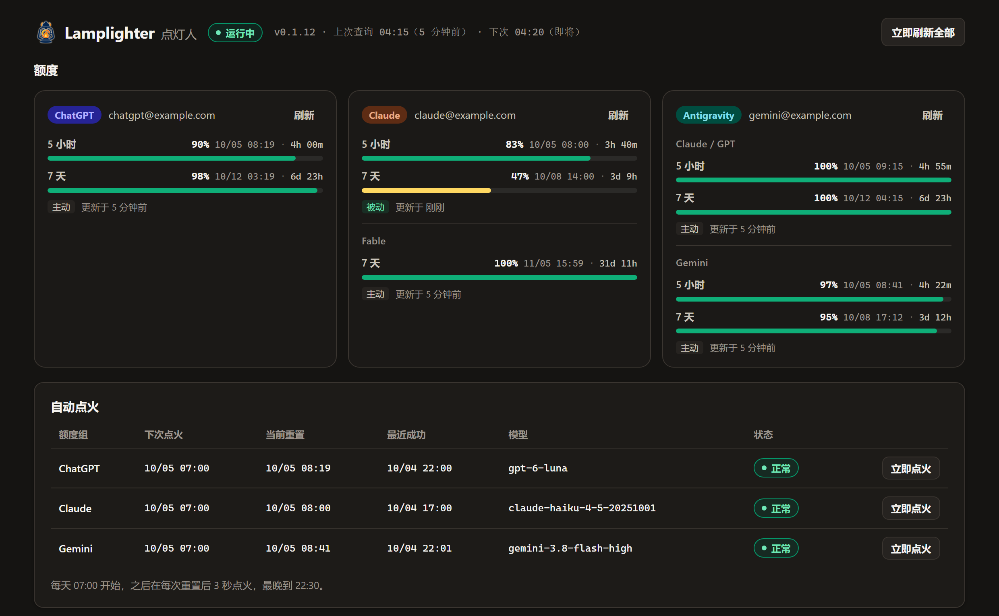
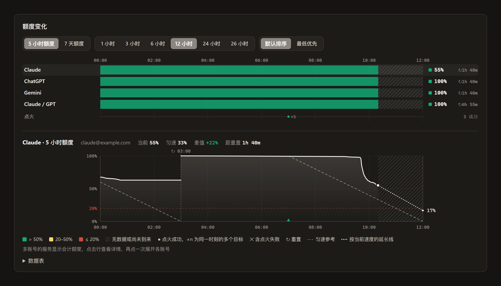
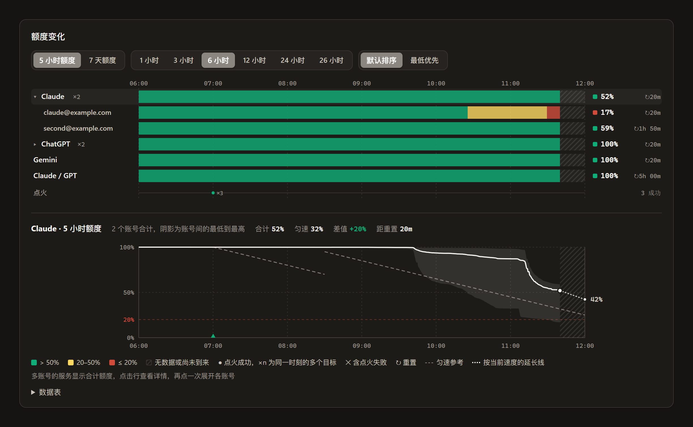

<p align="center"></p>

# Lamplighter

[中文](./README.md)

> When he lights his street lamp, it is as if he brought one more star to life, or one flower. — *The Little Prince*
>
> The lamplighter's planet turns once a minute, so every minute he lights his lamp and puts it out again, never missing a turn. Lamplighter does the same on schedule: each time a 5-hour quota window resets, it lights the next one.

Lamplighter is a native plugin for [CLIProxyAPI](https://github.com/router-for-me/CLIProxyAPI) (CPA). It monitors the quota of ChatGPT (Codex), Claude, Antigravity, Kimi and Grok accounts, sends alerts through [Bark](https://github.com/Finb/Bark) or a generic webhook, and sends one minimal request after each 5-hour quota window resets so that the next window starts right away.







## Features

- **Quota monitoring**: queries quota on a schedule and also reads the quota that upstream providers return while CPA serves real requests.
- **Notifications** through Bark or a webhook (Feishu, ntfy, DingTalk, Telegram and others): alerts when remaining quota drops to 50%, 20%, 10% and zero, and when the plan of an account changes, for example when a subscription expires; optional recovery and pre-reset reminders; optional forwarding of [Did Codex Reset](https://didcodexreset.com/) signals.
- **Window ignition**: from 07:00 every day, sends a minimal request 3 seconds after each 5-hour reset, until 22:30. The request goes through CPA's own model executor and is pinned to one account.
- **Management page**: shows quota, ignition plans, events and a quota chart in the CPA Management Center, and edits the settings.

| Service | Monitored | Ignition by default |
| --- | --- | --- |
| ChatGPT / Codex | 5-hour and 7-day windows | On |
| Claude | 5-hour and 7-day windows, plus separately counted quotas such as Fable | On, 5-hour window only |
| Antigravity | Quota groups such as Gemini and Claude / GPT | Off; when on, Gemini only |
| Kimi | 5-hour, 7-day and other windows | Not supported: the windows switch at fixed times |
| Grok | 7-day window | Not supported: a new period starts when the previous one ends |

Kimi quota queries follow the CPA Management Center; parsing is tested with a real response a user provided, but the requests have not run against a real account yet. Grok accounts billed by API usage have no quota to read and show an error. Accounts without a 5-hour window, such as ChatGPT Pro, are monitored for their other windows and not ignited.

Notifications and the page name the quota group of ChatGPT accounts `GPT`, so that it does not start with the same letter as Claude. When a service has several accounts, notifications and the page tell them apart by the last two characters of the email user name, for example `GPT#rk`. A named account shows its name instead, for example `GPT#main`. To name an account, click "Name" on its card in the Lamplighter page, or edit the credential's "Note" in the CPA Management Center. The name is the first line of the note, cut at 20 characters. A service with one account also shows its name. When a name equals the name or email suffix of another account of the service, the email suffix follows the name. For a note with more lines, clearing the name in the Lamplighter page deletes the whole note. A note changed in the CPA Management Center takes effect after the next poll or a manual refresh. Recorded events keep their original label.

When a service has several accounts, the total in the chart averages their remaining quota by weight; the weight says how many times the quota of the service's cheapest paid plan the account has. The default weight follows the detected plan, whose name shows at the bottom of the account card. The ChatGPT plan comes with the quota query. The Claude and Antigravity plans are read from the account profile once a day per account, and again at once when the account starts or stops reporting a quota window, for example when the 5-hour Gemini window disappears after Google AI Pro expires. A failed read keeps the plan read before, and the weight is 1 until a plan has been read. "Weight" on an account card sets a weight by hand, decimals allowed; leave it empty to restore the default. Weights set by hand are saved in `account_weights` and take precedence over the defaults. A weight other than 1 shows after the account title, for example `×5`.

| Service | Plan | Default weight |
| --- | --- | --- |
| ChatGPT | Free, Go | 0.1 |
| ChatGPT | Plus, Business, Enterprise, Edu | 1 |
| ChatGPT | Pro $100, Business Premium | 5 |
| ChatGPT | Pro $200 | 10 |
| ChatGPT | Pro $500 | 25 |
| Claude | Pro, Team, Enterprise | 1 |
| Claude | Max 5x | 5 |
| Claude | Max 20x | 20 |
| Antigravity | Free, Pro, Ultra | 1 |

Other services and unknown plans default to 1.

When the plan of an account changes, for example when Google AI Pro expires or is renewed, the plugin sends a 🎫 notification such as `🎫 Antigravity · plan Pro → Free`. Quota alerts of the account then start over with the quota of the new plan: it is only recorded, not reported as a recovery or a drop. The first plan read for an account is only recorded. The Claude plan is read once a day; after a Claude plan changes and before the new plan is read, quota alerts still compare with the quota of the old plan. The same happens when the plan changes later than the quota windows, or when reading the plan keeps failing for more than an hour, which can send one false recovery or drop alert.

## Requirements

- CPA v8.0.4 or later with plugins enabled (`plugins.enabled: true`). The plugin is built for Linux amd64/arm64, macOS amd64/arm64 and Windows amd64; the macOS builds are only built and tested in CI and have not been tried on a running CPA.
- A CPA API key reserved for Lamplighter. The plugin reads the model list with it to pick ignition models.
- For notifications, an iPhone with Bark or a service that accepts webhooks.

## Installation

1. Download the zip for the system CPA runs on from [Releases](https://github.com/PosvdM/cpa-plugin-lamplighter/releases): on Linux, `linux_amd64` when `uname -m` prints `x86_64` and `linux_arm64` when it prints `aarch64`; `darwin_arm64` for Apple silicon Macs, `darwin_amd64` for Intel Macs; `windows_amd64` for Windows.
2. Extract the library (`lamplighter-v<version>.so` on Linux, `.dylib` on macOS, `.dll` on Windows) into the `<os>/<arch>/` folder of the CPA plugin directory, for example `plugins/linux/arm64/` or `plugins/windows/amd64/`. In a Docker deployment the plugin directory is the host folder mounted at `/CLIProxyAPI/plugins`.
3. Add an API key to CPA's `config.yaml` and enable the plugin:

   ```yaml
   access:
     api-keys:
       - "existing key"
       - "new key for Lamplighter"
   plugins:
     enabled: true
     configs:
       lamplighter:
         enabled: true
         models_api_key: "new key for Lamplighter"
         bark_url: "https://api.day.app/your_device_key"
   ```

4. Restart CPA (`docker compose restart` in a Docker deployment). The plugin runs its first query about 20 seconds after CPA starts.
5. Open **Lamplighter** in the Management Center sidebar. If you signed in to the Management Center with "remember password", the page uses that key; otherwise it asks for one.

The plugin checks for a new version every 6 hours and whenever the management page opens. When a new version is out, a green up arrow appears to the right of the version in the management page header; clicking it opens the release page. To upgrade, update the plugin in the plugin store of the CPA Management Center; for a manual install, put the new library in the same folder, delete the old one and restart CPA.

The plugin keeps its state and quota history in `data/lamplighter/` under the plugin directory. In a Docker deployment that directory is on the host, so recreating the container keeps the data.

## How quota is read

**Active queries** run every 5 minutes by default, at minutes `00 / 05 / 10 / ... / 55` of each hour. In addition, the plugin queries the account once 30 seconds before and once 30 seconds after each quota window resets: the first records what is left at the end of the cycle, the second confirms the new cycle and sends the recovery notification without waiting for the next poll. A query is skipped when a newer reading already exists. Queries use the same URLs and headers as the quota page of the CPA Management Center.

**Passive data**: when a Claude or Codex model request passes through CPA, the provider returns the current quota in the response, and the plugin uses it without an extra request. Antigravity, Kimi and Grok return no such data and are only queried actively. A window that only appears in the response headers and not in the usage API is no longer shown after an active query, such as the 5-hour window of a ChatGPT Pro account.

If an account produced passive data in the 60 seconds before a scheduled query, that query is skipped for the account. An account is skipped for at most 30 minutes in a row; after that it is queried actively, so that quotas missing from the response headers, such as an unused Claude Fable quota, stay current. The chart does not draw this planned interval as missing data.

Claude and Codex quotas have 1% precision, whether queried or read passively. Antigravity queries return decimals, and so can Kimi, whose percentage is computed from used and limit counts.

When an upgrade removes a window and a downgrade brings it back, its first returning reading only establishes a new alert baseline, without recovery or pre-reset notifications. Disappearance sends no notification. Absence confirmed by an active query persists across plugin restarts. Passive response headers cannot restore an absent window; only a later successful active query can restore it. When reading an older state file, the plugin attempts to recover the last actively confirmed window set. Existing quota groups whose set cannot be recovered wait for a successful active query; response headers cannot add windows to those groups in the meantime. An absent 5-hour window is not ignited; ignition resumes automatically when it returns. History retains retired windows.

**Network exit**: active queries leave through the same exit that CPA uses for model requests of the account: the account's `proxy_url`, then the global `proxy-url`, then proxies from environment variables, then a direct connection. When an account's `proxy_url` cannot be parsed, the plugin skips the query instead of connecting directly.

## Window ignition

A 5-hour window starts with the first request after a reset. If nobody uses the account after a reset, no window runs. Lamplighter sends a request right after each reset so that the windows follow each other. Kimi windows switch at fixed times and Grok has no 5-hour window, so neither is ignited. The rules:

- Times use the plugin time zone, which follows the CPA server by default.
- The first ignition each day is at `07:00`; after that, 3 seconds after each reset, until `22:30`. A reset later than that waits for 07:00 the next day.
- The request asks the model to reply `OK`, declares no tools and allows at most 4 output tokens.
- Models are picked automatically: the newest Luna for ChatGPT, the newest Haiku for Claude, and the newest Flash for Antigravity's Gemini group. A model is used from the first ignition after CPA lists it; when the provider refuses it, that ignition falls back to the next candidate; when the fallback works, an event is recorded and the quota group skips the refused model for 24 hours. They can also be set in the config.
- An ignition counts as successful only when the 5-hour window afterwards has a fixed reset time in the future.

**Failure protection**:

- Authentication failures, rate limits (429), unavailable models, or a request that succeeded without starting the window pause ignition for that quota group until 07:00 the next day, with one notification.
- Network and server errors are retried after 5 and 15 minutes; a third failure also pauses until the next day.
- When the quota ran out before the reset, CPA cools the account down until a dozen or so seconds after the reset. An ignition that hits this cooldown retries as soon as it ends and is not counted as a failure.
- When the account's 7-day quota (or another window other than the 5-hour one) is used up, scheduled ignition for the quota group stops until that window resets and a query shows the quota is back; the page shows "7 天额度已用完". "Ignite now" still works.
- When the quota comes back early, for example after a reset card, while CPA still cools the account down until the original reset, CPA rejects every request and ignition in between. The plugin sends one ⚠️ notification and shows a note on the account card; clear the account's cooldown in the CPA Management Center.

## Notification example

Notifications use the Management Center language from the last time the management page was opened, Chinese or English; until the page has been opened, they are in Chinese.

```text
🟡 Claude · 7d 48% | 03d

5h: 96% | 04h | 10/04 13:50
7d: 48% | 03d | 10/07 14:00
```

Title icons: 🟡 remaining fell to the first threshold (50% by default), 🔴 to the second threshold (20% by default) or below, ✅ recovered, ⏰ reset reminder, 🎫 plan changed, ⚠️ a problem that needs action, such as ignition paused or a CPA cooldown that outlasts the quota. Each body line shows the window, the remaining quota, the time until reset, and the reset time. The first time the plugin sees a quota window it only records the current level and sends nothing.

## Configuration

All settings live under `plugins.configs.lamplighter` in `config.yaml`. On the management page, use the "Quota | Settings" switch at the top to open the settings view. Switches and checkboxes save when clicked; text and numbers save when you leave the field or press Enter. Each field shows its save result. The three alert thresholds save together and must be in descending order, with equal values allowed. Changes apply without a restart. A saved field shows "Saved; waiting to take effect", then "In effect" after the plugin confirms it; confirmation waits at most 15 seconds after the save succeeds, even if status requests hang. If still unconfirmed at the deadline, it shows "Not confirmed in effect"; a late confirmation does not change that wait result. During consecutive edits, confirmation of an earlier save does not overwrite a later change. MCP settings also show why the endpoint failed to start.

| Key | Default | Description |
| --- | --- | --- |
| `bark_url` | empty | Bark push URL up to the device key; empty disables Bark |
| `bark_group` | `CPA` | Bark notification group |
| `bark_icon` | Lamplighter logo | Notification icon |
| `webhook` | empty | Generic webhook, see [Webhook](#webhook) |
| `notice_threshold` | `50` | First alert level (remaining percent) |
| `low_threshold` | `20` | Second alert level |
| `critical_threshold` | `10` | Third alert level |
| `recovery_notify` | 5-hour `after_exhausted`, 7-day `all` | Recovery notifications, see below |
| `reset_reminder` | 5-hour `off`, 7-day `has_remaining` | Reset reminders, see below |
| `timezone` | empty | Time zone for displayed times and the ignition window, such as `Asia/Shanghai`; empty follows the CPA server (set by `TZ` in the official Docker image) |
| `timezone_offset_hours` | empty | Fixed UTC offset such as `8`; used only when `timezone` is empty |
| `poll_interval_seconds` | `300` | Active query interval, at least 60 |
| `request_timeout_seconds` | `20` | Timeout of one upstream request |
| `passive_skip_seconds` | `60` | Skip the query when passive data arrived this many seconds before it; `0` never skips |
| `passive_skip_max_minutes` | `30` | Longest run of skipped queries for one account |
| `models_api_key` | empty | CPA API key for reading the model list; without it ignition cannot pick a model. The management key does not work here; the page does not save the management key or a key CPA does not accept, and says why |
| `cpa_base_url` | `http://127.0.0.1:8317` | Address the plugin uses to reach CPA; change it when CPA uses another port or TLS |
| `history_retention_days` | `40` | Days of quota history to keep |
| `remember_chart_filters` | `false` | The management page remembers, in the current browser, the quota window, time range and order last chosen in the quota chart; when off, the page opens with the defaults |
| `account_weights` | empty | The weight of each account in the total of several accounts, keyed by credential file name, a number above 0; accounts without one use the default of their plan, see above |
| `account_order` | empty | Account order by credential file name; unlisted accounts follow in default order and missing entries are ignored |
| `mcp_enabled` | `false` | Enable the independent MCP server, see [MCP](#mcp) |
| `mcp_listen` | `127.0.0.1:8318` | MCP listen address |
| `mcp_key` | empty | Dedicated MCP Bearer key; empty prevents listening |
| `config_token` | empty | Configuration acknowledgment token generated on each page save; usually no manual setting is needed. See [Architecture (in Chinese)](./docs/architecture.md#与-cpa-的接口) |
| `data_dir` | `data/lamplighter` in the plugin directory | State and history directory |

Alert thresholds are normalized to `100 ≥ notice_threshold ≥ low_threshold ≥ critical_threshold ≥ 0`: later levels cannot exceed earlier ones. The normalized values take effect and the adjustment is logged.

With both `bark_url` and `webhook.url` empty, notifications are off: nothing is sent and no failed notifications are logged as events. Quota alerts from that time are not sent once a URL is set; Did Codex Reset signals that have not expired are still sent.

Recovery notifications and reset reminders are set per window: `five_hour` for 5-hour windows and `seven_day` for 7-day windows.

| Key | Values | Description |
| --- | --- | --- |
| `recovery_notify` | `off`, `all`, `after_exhausted` | `all`: notify every time the window resets; `after_exhausted`: after the window runs out, notify once at its next reset |
| `reset_reminder` | `off`, `all`, `has_remaining` | 5-hour windows are reminded 1 hour before the reset, 7-day windows 1 day before; `has_remaining`: remind only when more than `critical_threshold` is left |

The first line of a recovery notification is what was left when the previous cycle ended. This value comes from the active query 30 seconds before the reset; usage in those last 30 seconds is not counted. Without a reading from the last 15 minutes before the reset, the line is left out. A cycle that was never used (still 100% before the reset) is not notified. A window that is neither a 5-hour nor a 7-day window counts as a 7-day window once it was seen more than a day before its reset, and as a 5-hour window otherwise.

`notify_recovery` and `notify_reset_reminders` set both windows of the matching key to `all` when `true` and to `off` when `false`. They apply only when `recovery_notify` or `reset_reminder` is absent; changing the matching notification setting on the management page replaces them with the new keys.

Ignition settings live under `ignition`:

| Key | Default | Description |
| --- | --- | --- |
| `enabled` | `true` | Enable window ignition |
| `start_hour` | `7` | Hour of the first ignition each day |
| `end_hour` | `22` | Hour at which ignition stops |
| `end_grace_minutes` | `30` | Minutes after `end_hour` that are still allowed |
| `grace_seconds` | `3` | Seconds to wait after a reset |
| `failure_retry_seconds` | `300` | Wait before the first retry after a transient error |
| `failure_backoff_multiplier` | `3` | Factor applied to the wait on each retry |
| `max_transient_failures` | `3` | Transient errors that pause ignition until the next day |
| `post_success_hold_seconds` | `60` | Minimum wait after a successful ignition |

Per-service settings live under `providers`, keyed `codex`, `claude`, `antigravity`, `kimi` and `xai` (Grok). CPA can name Kimi accounts `kimi-ai` and similar; any of these keys counts as `kimi`. Kimi and Grok cannot be ignited, so `ignite` has no effect for them:

| Key | Description |
| --- | --- |
| `monitor` | Monitor this service |
| `ignite` | Ignite this service |
| `model` | Ignition model; empty picks one automatically. It must appear in CPA's model list |
| `groups` | Antigravity only: quota groups to ignite, default `["Gemini"]` |
| `models` | Antigravity only: model per quota group, for example `{"Gemini": "gemini-3.5-flash-lite"}` |

`codex_reset_updates` controls Did Codex Reset forwarding: `enabled` (default `false`), `poll_seconds` (default `300`, at least 300) and `notify_current_pending` (default `true`: on first enable, notify the pending scheduled reset). Only schedules that have not passed and resets completed in the last 48 hours are forwarded, and a later post about a schedule is sent as an update only when its confidence, time or plans change; schedule times are shown in the local time zone, and date-only schedules as a time range. Did Codex Reset is a third-party monitor; its signals are not official OpenAI announcements.

Full example:

```yaml
plugins:
  configs:
    lamplighter:
      enabled: true
      bark_url: "https://api.day.app/your_device_key"
      models_api_key: "new key for Lamplighter"
      ignition:
        enabled: true
        start_hour: 7
        end_hour: 22
      providers:
        codex:
          ignite: true
        claude:
          ignite: true
        antigravity:
          ignite: true
          groups: ["Gemini"]
      codex_reset_updates:
        enabled: true
```

## MCP

MCP lets coding agents query quota through standard Streamable HTTP, independently of the client. The plugin listens on `127.0.0.1:8318` at `/mcp` and requires a dedicated Bearer key. The CPA management key does not authenticate this endpoint. Protocol versions `2025-03-26` and `2025-06-18` are supported; responses are JSON only, without SSE.

Enable MCP in the settings view; if no key is set, the page generates one in the same save. You can also generate a new key separately or configure these keys under `plugins.configs.lamplighter`:

```yaml
mcp_enabled: true
mcp_listen: "127.0.0.1:8318"
mcp_key: "<dedicated MCP key>"
```

Use a cryptographic random generator for the key, for example 32 random bytes encoded as base64url with an `llmcp_` prefix. An empty key prevents the listener from starting and reports the reason in management status. Changes to the switch, address or key apply automatically. Status uses `config.mcp_key_set` only to indicate whether a key is set. The top-level `config_applied_token` confirms completion of configuration application; check the listener state and error to determine whether the endpoint is usable. The original key is stored in CPA configuration and can be read by anyone with the management key. In Docker, the loopback address belongs to the CPA container. A local agent can share that network namespace; other deployments should connect a reverse proxy through a restricted container network without publishing an unencrypted MCP port.

### Client connections

The default URL within the same network namespace is `http://127.0.0.1:8318/mcp`. Replace it with an HTTPS URL for remote access. `<key>` below is the dedicated MCP key.

Claude Code:

```sh
claude mcp add --transport http lamplighter http://127.0.0.1:8318/mcp --header "Authorization: Bearer <key>"
```

Codex CLI, with the key provided through an environment variable:

```sh
export LAMPLIGHTER_MCP_KEY='<key>'
codex mcp add lamplighter --url http://127.0.0.1:8318/mcp --bearer-token-env-var LAMPLIGHTER_MCP_KEY
```

Generic client configuration example; check the client's documentation for its configuration format:

```json
{"mcpServers":{"lamplighter":{"type":"http","url":"http://127.0.0.1:8318/mcp","headers":{"Authorization":"Bearer <key>"}}}}
```

Clients that only support stdio can connect through `mcp-remote`:

```sh
npx mcp-remote http://127.0.0.1:8318/mcp --header "Authorization: Bearer <key>"
```

### HTTPS reverse proxy

Do not expose the listener directly to the public Internet. For remote use, keep MCP on loopback and terminate TLS with a reverse proxy on the same host. Add firewall restrictions or an allowlist as needed. Preserve the `Authorization` and `MCP-Protocol-Version` headers. Browser requests with a non-local `Origin` are rejected; ordinary MCP agents usually omit this header.

Nginx example; replace the domain and certificate paths:

```nginx
server {
    listen 443 ssl;
    server_name quotas.example.com;
    ssl_certificate /etc/letsencrypt/live/quotas.example.com/fullchain.pem;
    ssl_certificate_key /etc/letsencrypt/live/quotas.example.com/privkey.pem;
    location = /mcp {
        proxy_pass http://127.0.0.1:8318/mcp;
        proxy_set_header Authorization $http_authorization;
        proxy_set_header MCP-Protocol-Version $http_mcp_protocol_version;
        proxy_read_timeout 190s;
    }
}
```

Caddy example; point the domain at the proxy and let Caddy obtain the HTTPS certificate:

```caddyfile
quotas.example.com {
    reverse_proxy /mcp 127.0.0.1:8318 {
        transport http {
            response_header_timeout 190s
        }
    }
}
```

### Tools

| Tool | Purpose |
| --- | --- |
| `list_quotas(provider?, account?, model?)` | Current windows, account plans and weights, weighted remaining quota, earliest account exhaustion, resets, forecasts, hourly consumption, seven-day even-pace budgets, freshness and source, credential authentication errors and next ignition |
| `get_quota_history(provider?, account?, window?, range?)` | Quota history including retired windows; at most 200 points per series and 2000 points per response |
| `refresh_quotas(account?)` | Active query, globally limited to once per 60 seconds; returns remaining wait seconds when throttled and waits at most 180 seconds for results |
| `get_quota_events(since?, limit?)` | Recent reset, exhaustion and ignition success/failure events; `since` is an RFC3339 timestamp with timezone and `limit` an integer from 1 to 100 |

Each MCP server instance executes at most four tool calls concurrently, including calls within a batch. Additional calls immediately receive a JSON-RPC `-32000` busy error and may be retried later. Query tools have a 10-second timeout; `refresh_quotas` has a 180-second timeout.

`account` matches the first line of the note or the email exactly. Use a unique email for refresh when names are ambiguous. Accounts without either use `account-number`. Times include both ISO timestamps with timezone and relative descriptions. Forecasts depend on continued use at the measured rate and are not guarantees; stale or unknown predictions are `null`. A `model` query returns candidate quota pools with `certain: false`: CPA also applies model aliases, credential availability, cooldowns and session routing during actual requests, so the plugin cannot guarantee which account will be selected. After a 429, refresh first and use the actual reset and CPA cooldown times to schedule a retry rather than relying only on a forecast. Events are filtered from at most 200 retained engine events of all kinds.

## Webhook

Besides Bark, you can set up one webhook to send notifications to Feishu, ntfy, DingTalk, Telegram and other services, or to your own program. With both channels set, every notification goes to both; it counts as delivered as soon as one of them accepts it and is not retried, and the channel that failed is logged as a "Notification failed" event.

| Key | Default | Description |
| --- | --- | --- |
| `url` | empty | Request URL; empty disables the webhook |
| `method` | `POST` | `GET`, `POST` or `PUT` |
| `headers` | empty | Request headers, such as `Authorization: Bearer <token>` |
| `body` | empty | Request body; empty sends the built-in JSON message. Not allowed with `GET` |
| `success_json` | empty | Success condition: these top-level fields of the JSON response must have the given values, such as `code: 0`; empty only requires a 2xx HTTP status |

The URL, headers and body can use placeholders:

| Placeholder | Content |
| --- | --- |
| `{{title}}` | Notification title |
| `{{body}}` | Notification body |
| `{{text}}` | Title and body, separated by a line break |
| `{{url}}` | Link; only Did Codex Reset notifications have one, empty otherwise |
| `{{priority}}` | `high` when quota drops to the third threshold or runs out, the plan changes, ignition pauses or a CPA cooldown is not cleared; `normal` otherwise |
| `{{kind}}` | Notification type: `quota` quota drop, `recovery` quota recovered, `reminder` reset reminder, `plan` plan changed, `cooldown` CPA cooldown not cleared, `circuit` ignition paused, `codex_reset` Did Codex Reset, `test` test notification |
| `{{label}}` | Quota group, such as `GPT#rk` or `GPT#main`; empty for notifications not about a quota group |
| `{{time}}` | Time sent, in RFC 3339 format and the plugin time zone |

Placeholders are escaped for where they appear: URL-encoded in the URL; JSON-string-escaped in a JSON body, so put them inside quotes; form-encoded in a form body; with line breaks replaced by spaces in headers. Without a `Content-Type` header, a body that is JSON (with placeholders inside quotes) is sent as JSON and anything else as plain text.

Without `body`, the webhook receives this JSON:

```json
{"source":"lamplighter","kind":"quota","title":"🔴 GPT#rk · 5h 8% | 03h","body":"5h: 8% | 03h | 10/10 19:00\n7d: 60% | 04d | 10/14 09:00","text":"…","url":"","priority":"high","label":"GPT#rk","time":"2026-10-10T16:00:00+08:00"}
```

Settings for common services follow. They are format examples based on each service's documentation and have not all been tested.

| Service | `url` | `body` | `success_json` |
| --- | --- | --- | --- |
| ntfy | `https://ntfy.sh/` | `{"topic":"<topic>","title":"{{title}}","message":"{{body}}"}` | not needed |
| Feishu / Lark | `https://open.feishu.cn/open-apis/bot/v2/hook/<token>` | `{"msg_type":"text","content":{"text":"{{text}}"}}` | `code: 0` |
| DingTalk | `https://oapi.dingtalk.com/robot/send?access_token=<token>` | `{"msgtype":"text","text":{"content":"{{text}}"}}` | `errcode: 0` |
| WeCom | `https://qyapi.weixin.qq.com/cgi-bin/webhook/send?key=<key>` | `{"msgtype":"text","text":{"content":"{{text}}"}}` | `errcode: 0` |
| Discord | `https://discord.com/api/webhooks/<id>/<token>` | `{"content":"{{text}}"}` | not needed |
| Slack | `https://hooks.slack.com/services/<path>` | `{"text":"{{text}}"}` | not needed |
| Telegram | `https://api.telegram.org/bot<token>/sendMessage` | `{"chat_id":"<chat_id>","text":"{{text}}"}` | not needed |

For Feishu, `config.yaml` looks like this. The body contains `{{`, so put it in single quotes:

```yaml
plugins:
  configs:
    lamplighter:
      webhook:
        url: "https://open.feishu.cn/open-apis/bot/v2/hook/<token>"
        body: '{"msg_type":"text","content":{"text":"{{text}}"}}'
        success_json:
          code: 0
```

- Feishu, DingTalk and WeCom answer HTTP 200 when a message fails too, with the error code in the response, so set `success_json`; otherwise failed deliveries count as successful.
- Signature verification of Feishu and DingTalk bots is not supported. Use a custom keyword or an IP allowlist in the bot's security settings instead; with a keyword, put it in the body, such as `"text":"Lamplighter {{text}}"`.
- "Send test" on the management page shows the result of each channel and the start of the webhook response. Without `success_json`, the page notes that only the HTTP status was checked, so confirm that the message arrived.
- When the webhook settings are invalid, for example a misspelled placeholder, the webhook stays off and the management page shows the reason at the top; the other settings still apply.

## Management page

Use the "Quota | Settings" switch at the top to change views. The browser remembers the last view. The quota view shows:

- the quota windows of each account with reset times, data sources and plan, with buttons to refresh each account, name it or set its weight in the total; drag a card by its handle or use its move-up and move-down buttons to save the order in `account_order`, which also sets the default chart order;
- five color levels shared by quota bars and charts: full at a raw remaining value of 100%, empty at 0%, and high, medium and low between them, split by the first two alert thresholds; 99.6% does not use the full color even when rounded to 100% for display;
- the next ignition, last result and failure protection state of each quota group, with an "ignite now" button; hidden while ignition is off;
- a quota chart:
  - It shows either the 5-hour quota, over 1, 3, 6, 12, 24 or 26 hours (6 by default), or the 7-day quota, over 1, 4, 8 or 15 days, one month (from this date last month) or 36 days (8 days by default). Window kinds and chart rows include current windows and windows with samples in the selected history range. A current window without new samples in the range keeps its row, with missing intervals marked as no data. Windows of other lengths only show on the account cards. With `remember_chart_filters` on, the page keeps the last choices.
  - 1 and 3 hours and 1 and 4 days end now. Longer ranges end at the reset of the selected row's current window; 6 hours, for example, shows the current 5-hour window and the last hour of the previous one, with the time after now hatched. When the selected row has no reset, or its reset has passed (a 5-hour window no request has opened yet), these ranges also end now.
  - The top part has one colored band per service, colored like the quota bars by the lowest reading so far in each cycle. The default order follows the account cards: each service takes the position of its first account, and groups within the same account keep their group order. You can also sort by lowest remaining. A service with several accounts shows their weighted total and expands into one row per account.
  - A window the account no longer reports is marked "Inactive" until its last sample leaves the selected range. It gets a separate row and is excluded from totals and lowest-first ordering. Its curve ends at the last reading, without an even-pace line or projection.
  - The bottom part plots the selected row with its resets and ignition results. Its even-pace line uses the scheduled reset recorded at each time and a fixed 5-hour or 7-day length, falling linearly from 100% to 0% at that reset. An early reset cuts the old reference where the new reset is first observed and starts a reference for the new schedule. No reference is drawn while the reset is unknown. If the current window loses its reset time, the reference stops at the chart’s current-time boundary instead of extending toward the previous reset. A curve above the reference is using quota slower than an even pace. A total shows the weighted mean reference only while every account has a reference value. Its header shows the current remaining, the even-pace value now and the difference between them, green above the pace and red below. When the chart ends now, these three values also appear right of the plot, at the ends of the curve and the even-pace line.
  - When the chart ends at a reset, a projection starts now: if the quota runs out first, the time (and the date for the 7-day quota) is marked on the time axis; if the reset comes first, what will be left is marked right of the plot.
    - The 5-hour quota is projected at the current rate, showing where use at that rate would lead. The rate comes from the latest stretch of steady use in this cycle, so in the first minutes of heavy use the projected time comes too early.
    - The 7-day quota is projected at this cycle's daily average: what the cycle has used so far over the time since it began, including the time without use. In the first day or two of a cycle the projection is less accurate.
  - The page reads the status every 30 seconds and updates the chart when there is new data; while the pointer is over the chart, the update waits until it leaves.
- recent events in columns for time, type, quota group and detail.

The eye button in the header switches between "Blur accounts" and "Show accounts". It blurs current account identifiers and old names retained in events and history charts, including labels of renamed or deleted accounts. Upstream errors and older event details that cannot be reliably split are blurred as a whole. Reloading restores visibility. Dialogs such as account naming still show the original text. Blurring affects display only and does not remove the original data from API responses or the page.

Camera buttons on each account card, in the cards header and in the detail-chart header copy one card, all cards or the detail chart to the clipboard as a PNG. Screenshots retain the current theme and blur state and omit action buttons. This requires a browser with image-clipboard support, a secure context such as HTTPS or localhost, and clipboard permission. Unsupported browsers disable the buttons.

The settings view contains notification, ignition, provider and MCP configuration. "Send test" in the notification settings waits for pending saves and then uses the configuration token to wait up to 15 seconds for the plugin to confirm application; a hanging status request does not extend this wait. After confirmation it sends to every configured channel and shows each result; on timeout it reports "The new settings are not in effect yet, so the test was not sent" and sends nothing. An empty ignition model field shows the model the next ignition will use in its hint; for Antigravity, the model of the Gemini group. Services that cannot be ignited show "No ignition". The model list is read when the plugin starts, when `cpa_base_url` or `models_api_key` changes and for every ignition, so a model newly listed by CPA shows after the next ignition, which already uses it.

The page follows the language of the CPA Management Center: Chinese for Simplified or Traditional Chinese, English for every other language.

## Security and risk

- The plugin reads the access token from the credential file into memory only to query quota, and never writes it to logs or disk. The page's data API requires the CPA management key; MCP uses its own key.
- `bark_url`, `webhook`, `models_api_key` and `mcp_key` are stored in plain text in CPA's `config.yaml`, visible to anyone with the management key.
- Each service restricts the use of subscription accounts through third-party tools in its own way. Using accounts through CPA, sending scheduled ignition requests and querying quota may all put accounts at risk. Use it at your own discretion.

## Development

Plugin structure, data flow and design constraints are in [Architecture (in Chinese)](./docs/architecture.md); building, testing and releasing are in [Development (in Chinese)](./docs/development.md).

## License

[AGPL-3.0-or-later](./LICENSE). If you distribute a modified version, or let others use one over a network, you must publish its source code under the same license.
